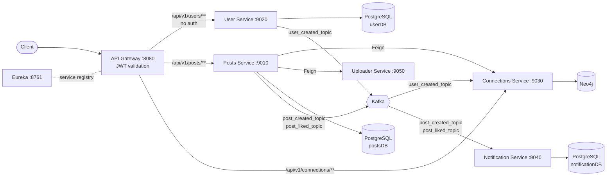
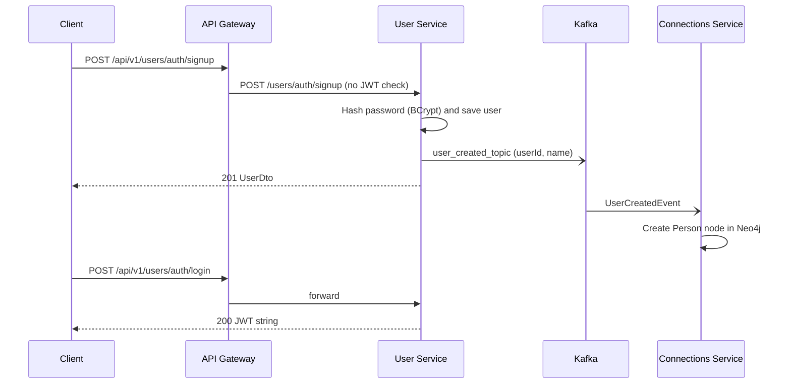
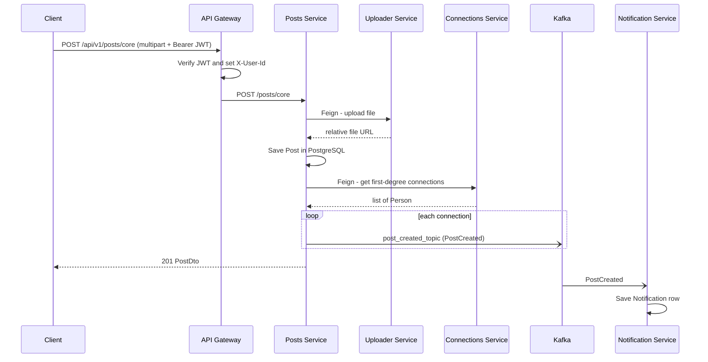

**# LinkedIn Clone — Microservices Backend**


A backend-only, LinkedIn-style social platform built with **Java 21** and **Spring Boot** as a set of independent microservices. Users sign up and log in with JWT, build a connection graph in **Neo4j**, publish posts with an image and like them (**PostgreSQL**), and notification records are created asynchronously from **Kafka** events. Services communicate through **OpenFeign** (synchronous) and **Kafka** (asynchronous) and are fronted by **Spring Cloud Gateway**.


> **Status:** learning/portfolio project. There is no frontend. Notifications are **persisted** to a database by Kafka consumers; there is currently no push (WebSocket/SSE) delivery and no REST endpoint to read them. See [Known limitations](#known-limitations).


---


## Table of contents**

1. [Features](#features)

2. [Architecture](#architecture)

3. [Services](#services)

4. [Tech stack](#tech-stack)

5. [Data model](#data-model)

6. [API reference](#api-reference)

7. [Getting started (local)](#getting-started-local)

8. [Configuration](#configuration)

9. [Testing](#testing)

10. [Containers & Kubernetes](#containers--kubernetes)

11. [Security notes](#security-notes)

12. [Known limitations](#known-limitations)

13. [Project structure](#project-structure)

14. [License](#license)


---


## Features**


| Area | Capability | Status |

|---|---|---|

| Auth | Sign up with BCrypt-hashed password | Implemented |

| Auth | Login returns a signed JWT (100-minute expiry) | Implemented |

| Auth | JWT validated at the API Gateway; user id forwarded as `X-User-Id` | Implemented |

| Connections | Send / accept / reject connection requests | Implemented |

| Connections | List first-degree connections of a user | Implemented |

| Connections | List pending requests, withdraw request, remove connection | Not implemented |

| Posts | Create post (text + **required** image), get post by id, list posts by user | Implemented |

| Posts | Edit/delete post, comments, feed | Not implemented |

| Likes | Like / unlike a post | Implemented |

| Likes | Like counts / list of likers | Not implemented |

| Events | Kafka events for user created, post created (one per connection), post liked | Implemented |

| Notifications | Consume events and store a `Notification` row per recipient | Implemented |

| Notifications | REST API to read notifications, real-time push, email/FCM | Not implemented (email/FCM are only code comments) |

| Uploads | Store uploaded files on local disk and return a relative URL | Implemented |

| Uploads | Cloudinary / Google Cloud Storage backends | Code present but **disabled** (`@Service` commented out) |

| Discovery | Eureka server; services register locally | Implemented (local only) |

| Deployment | Jib image config and Kubernetes manifests | Present; end-to-end deployment not verified |


---


## Architecture**





Locally, the gateway resolves services through Eureka (`lb://USER-SERVICE`, etc.). On Kubernetes the Eureka client is disabled and the gateway uses plain service DNS names (`http://user-service`) supplied through the `k8s` profile.


### Sign-up and login**





### Create a post and notify connections**





Liking a post follows the same pattern: `PostLikeService.likePost` saves a `PostLike`, publishes `PostLiked` to `post_liked_topic`, and the Notification Service stores a notification for the post owner.


---


## Services**


| Module | Port | Context path | Role | Storage |

|---|---|---|---|---|

| `DiscoveryServer` | 8761 | `/` | Eureka server | — |

| `APIGateway` | 8080 | `/` | Routing, JWT validation | — |

| `userService` | 9020 | `/users` | Sign-up, login, JWT issuing; publishes `user_created_topic` | PostgreSQL `userDB` |

| `postsService` | 9010 | `/posts` | Posts and likes; Feign client to Connections and Uploader; publishes post events | PostgreSQL `postsDB` |

| `ConnectionsService` | 9030 | `/connections` | Connection graph; consumes `user_created_topic` | Neo4j |

| `notification-service` | 9040 | `/notifications` | Consumes post events and stores notifications (no controllers) | PostgreSQL `notificationDB` |

| `uploader-service` (existing directory may still be named `uploder-service`) | 9050 | `/uploads` | File upload and download from local disk | Local path (`/tmp/linkedin-uploads` by default) |


Each module is an independent Maven project with its own `mvnw`. There is no parent/aggregator POM.


## Tech stack**


- **Language / build:** Java 21, Maven (wrapper per module), Lombok, ModelMapper 3.2.0

- **Frameworks:** Spring Boot 3.3.3 / 3.3.8 / 3.4.3 (varies per module), Spring Cloud 2023.0.5 / 2024.0.0

- **Gateway & discovery:** Spring Cloud Gateway, Netflix Eureka

- **Inter-service:** Spring Cloud OpenFeign (Posts Service), Apache Kafka via Spring Kafka (JSON serialization)

- **Auth:** JJWT 0.12.6 (HMAC-signed JWT), jBCrypt 0.4

- **Databases:** PostgreSQL (Spring Data JPA, `ddl-auto=update`), Neo4j (Spring Data Neo4j)

- **Packaging / deploy:** Jib 3.4.4, Kubernetes manifests (`k8s/`)


## Data model**


**PostgreSQL**


| Table | Columns |

|---|---|

| `users` | `id` (PK, identity), `name` (not null), `email` (not null, unique), `password` (BCrypt hash, not null) |

| `post` | `id`, `content` (not null), `image_url`, `user_id` (not null), `created_at` |

| `post_likes` | `id`, `user_id` (not null), `post_id` (not null), `created_at` — **no unique constraint on (user_id, post_id)** |

| `notification` | `id`, `user_id`, `message`, `created_at` |


**Neo4j:** `(:Person {userId, name})`, relationships `[:REQUESTED_TO]` (pending, sender → receiver) and `[:CONNECTED_TO]` (accepted).


**Kafka topics** (3 partitions, replication factor 1, created by `NewTopic` beans)


| Topic | Producer | Consumer | Payload |

|---|---|---|---|

| `user_created_topic` | userService | ConnectionsService | `{userId, name}` |

| `post_created_topic` | postsService | notification-service | `{ownerUserId, postId, userId (recipient), content}` |

| `post_liked_topic` | postsService | notification-service | `{postId, ownerUserId, likedByUserId}` |


---


## API reference**


All client traffic goes through the gateway at `http://localhost:8080`. The gateway removes the first two path segments (`/api/v1`) before forwarding. Protected routes need `Authorization: Bearer <JWT>`.


Errors from the services use this shape (where the exception is handled):

```json

{ "timeStamp": "2026-01-01T10:00:00", "error": "User already exists", "statusCode": "BAD_REQUEST" }

```


### Users (public)**


| Method | Path | Body | Success |

|---|---|---|---|

| POST | `/api/v1/users/auth/signup` | `{"name","email","password"}` | `201` `{"id","name","email"}` |

| POST | `/api/v1/users/auth/login` | `{"email","password"}` | `200` plain-text JWT |


### Posts (JWT required)**


| Method | Path | Notes | Success |

|---|---|---|---|

| POST | `/api/v1/posts/core` | `multipart/form-data`: part `post` (JSON `{"content":"..."}`, content-type `application/json`) and part `file` (**required**) | `201` `{"id","content","userId","createdAt"}` |

| GET | `/api/v1/posts/core/{postId}` | | `200` PostDto, `404` if missing |

| GET | `/api/v1/posts/core/users/{userId}/allPosts` | | `200` list of PostDto |

| POST | `/api/v1/posts/likes/{postId}` | Like as the current user | `204`; `400` if already liked, `404` if post missing |

| DELETE | `/api/v1/posts/likes/{postId}` | Unlike | `204`; `400` if not liked |


`PostDto` does not include `imageUrl`; the stored URL is not currently returned by any endpoint.


### Connections (JWT required)**


| Method | Path | Meaning | Success |

|---|---|---|---|

| GET | `/api/v1/connections/core/{userId}/first-degree` | Connections of `userId` | `200` list of `{"id","userId","name"}` |

| POST | `/api/v1/connections/core/request/{userId}` | Current user sends a request to `userId` | `204` |

| POST | `/api/v1/connections/core/accept/{userId}` | Current user accepts the request **from** `userId` | `204` |

| POST | `/api/v1/connections/core/reject/{userId}` | Current user rejects the request **from** `userId` | `204` |


### Internal only (not routed by the gateway)**


| Service | Method | Path |

|---|---|---|

| Uploader | POST | `/uploads/file` (multipart part `file`, returns relative URL string) |

| Uploader | GET | `/uploads/file/{fileName}` |


---


## Getting started (local)**


### Prerequisites**

- JDK 21

- Docker (for the infrastructure examples below) or your own PostgreSQL, Kafka and Neo4j

- `curl`


### 1. Start infrastructure (examples)**


```bash

# PostgreSQL with the three databases (names are case-sensitive in the JDBC URLs)

# Use local-only development credentials; never reuse these in a shared or public deployment.
docker run -d --name linkedin-pg -e POSTGRES_USER=muzammil -e POSTGRES_PASSWORD=password -p 5432:5432 postgres:16

# wait a few seconds, then:

for db in userDB postsDB notificationDB; do

  docker exec linkedin-pg psql -U muzammil -d postgres -c "CREATE DATABASE \\"$db\\";"

done


# Kafka (any broker reachable at localhost:9092 works)

docker run -d --name linkedin-kafka -p 9092:9092 apache/kafka:3.8.0


# Neo4j (matches the version used in k8s/connections-db.yml)

docker run -d --name linkedin-neo4j -p 7474:7474 -p 7687:7687 \\

  -e NEO4J_AUTH=neo4j/password neo4j:4.4.39-community

```


### 2. Start the services**


Start in this order, each in its own terminal. `spring-boot:run` does **not** trigger Jib (Jib is bound to `package`).


```bash

cd DiscoveryServer     && ./mvnw spring-boot:run   # 1. Eureka

cd userService         && ./mvnw spring-boot:run

cd postsService        && ./mvnw spring-boot:run

cd ConnectionsService  && ./mvnw spring-boot:run

cd uploader-service     && ./mvnw spring-boot:run

# notification-service has blank DB credentials in application.properties, so supply them:

cd notification-service && SPRING_DATASOURCE_USERNAME=muzammil SPRING_DATASOURCE_PASSWORD=password ./mvnw spring-boot:run

cd APIGateway          && ./mvnw spring-boot:run   # last

```


Give Eureka 30–60 seconds so the gateway can discover the other services. Check `http://localhost:8761`.


### 3. Smoke test**


```bash

BASE=http://localhost:8080/api/v1


curl -s -X POST $BASE/users/auth/signup -H 'Content-Type: application/json' \\

  -d '{"name":"Alice","email":"alice@example.com","password":"Passw0rd!"}'


TOKEN=$(curl -s -X POST $BASE/users/auth/login -H 'Content-Type: application/json' \\

  -d '{"email":"alice@example.com","password":"Passw0rd!"}')


curl -s -X POST $BASE/posts/core -H "Authorization: Bearer $TOKEN" \\

  -F 'post={"content":"Hello world"};type=application/json' \\

  -F 'file=@./photo.jpg'


curl -s $BASE/posts/core/users/1/allPosts -H "Authorization: Bearer $TOKEN"

```


Create a second user, then use the `connections` endpoints to connect them and verify that post/like events produce rows in the `notification` table.


---


## Configuration**


Defaults live in each module's `application.properties` / `application.yml`; Spring Boot relaxed binding lets environment variables override them.


| Setting | Where | Notes |

|---|---|---|

| `jwt.secretKey` | `APIGateway` and `userService` | **Must be identical in both.** Override with `JWT_SECRETKEY`; do not use any value committed to Git. |

| `spring.datasource.url/username/password` | user, posts, notification | Local defaults point to `localhost:5432` |

| `spring.neo4j.uri/authentication.*` | ConnectionsService | Default `bolt://localhost:7687`, `neo4j` / `password` |

| `spring.kafka.bootstrap-servers` | user, posts, connections, notification | Default `localhost:9092`; `kafka:9092` in the `k8s` profile |

| `eureka.client.service-url.defaultZone` | all except Discovery | Default `http://localhost:8761/eureka` |

| `local.storage-path` | uploader | Default `/tmp/linkedin-uploads` |

| `UPLOADER_SERVICE_URI`, `CONNECTIONS_SERVICE_URI` | postsService (Feign) | Defaults: `http://localhost:9050` and Eureka lookup |

| `USER_SERVICE_URI`, `POSTS_SERVICE_URI`, `CONNECTIONS_SERVICE_URI` | APIGateway | Default to `lb://…` via Eureka |

| `SPRING_PROFILES_ACTIVE=k8s` | all containers | Disables Eureka, reads `DB_*` variables |

| `DB_SERVER`, `DB_NAME`, `DB_USERNAME`, `DB_PASSWORD` | `k8s` profile | In ConnectionsService, `DB_NAME` is used as the Neo4j **host name** |


## Testing**


Each module contains one auto-generated `contextLoads()` test and nothing else. There are **no unit or integration tests** for business logic, security, Kafka or Feign. Because `@SpringBootTest` loads the full context against localhost infrastructure, `./mvnw test` will fail unless PostgreSQL / Kafka / Neo4j / Eureka are available. Adding real tests is the top item on the roadmap.


## Containers & Kubernetes**


**Images.** Jib is configured in all modules except `DiscoveryServer`, targeting `docker.io/muzammil7961/linkedin-app-<name>:<version>`. The Jib `build` goal is bound to `package`, so `./mvnw package` **pushes** to that registry. To avoid that:


```bash

./mvnw package -Djib.skip=true                 # build the jar only

./mvnw compile jib:dockerBuild                 # build into the local Docker daemon

```

Change the image name in each `pom.xml` to your own registry before publishing.


**Kubernetes.** `k8s/` contains Deployments/Services for the gateway, user, posts, connections, notification and uploader services, StatefulSets for three PostgreSQL instances and Neo4j 4.4, a 2-replica Kafka StatefulSet (KRaft), and a single Ingress routing `/` to the gateway.


```bash

kubectl apply -f k8s/kafka.yml

kubectl apply -f k8s/user-db.yml -f k8s/posts-db.yml -f k8s/notification-db.yml -f k8s/connections-db.yml

kubectl apply -f k8s/user-service.yml -f k8s/posts-service.yml -f k8s/connections-service.yml \\

              -f k8s/notification-service.yml -f k8s/uploader-service.yml

kubectl apply -f k8s/api-gateway.yml -f k8s/ingress.yml

```


Notes: the Discovery Server is not deployed (service DNS is used instead); the Ingress uses the `gce` class and PVCs use `standard-rwo`, which suggests a GKE target; credentials are plain `env` values (no Secrets); only the gateway has a readiness probe.


## Security notes**


- Replace the JWT secret and all default database credentials before any shared or public deployment, and keep them out of Git (use environment variables or Kubernetes Secrets).

- Downstream services trust the `X-User-Id` header added by the gateway. Do not expose service ports directly; restrict traffic with network policies.

- Enable TLS on the Ingress before sending real credentials.


## Known limitations**


- No real-time delivery and no API to read notifications; the gateway does not route to the notification or uploader services.

- Posts require an image; the stored image URL is never returned by the API and uploads are stored on local disk (ephemeral in containers).

- No request validation, pagination, rate limiting, or CORS configuration.

- Kafka publishing is fire-and-forget (no outbox, no consumer idempotency, no dead-letter topic); topics use replication factor 1.

- Check-then-act logic (likes, connection requests, sign-up) is not protected by database constraints, so concurrent requests can create duplicates.

- Only empty `contextLoads()` tests exist; no CI pipeline, Dockerfiles or docker-compose.

- Module versions are inconsistent (Spring Boot 3.3.3 / 3.3.8 / 3.4.3).


## Project structure**


```

.

├── APIGateway/            Spring Cloud Gateway + JWT filter

├── ConnectionsService/    Neo4j connection graph + Kafka consumer

├── DiscoveryServer/       Eureka server

├── notification-service/  Kafka consumers + notification storage

├── postsService/          Posts, likes, Feign clients, Kafka producers

├── uploader-service/       File upload service (local storage active)

├── userService/           Auth, JWT issuing, Kafka producer

└── k8s/                   Kubernetes manifests

```


## License**


Not specified yet — add a `LICENSE` file (for example MIT) before publishing.
